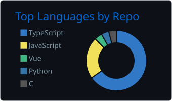
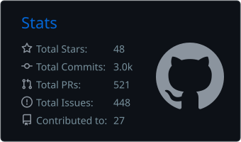
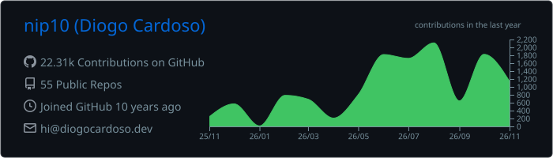

### Hi, I'm Diogo 👋

Senior Forward Engineer at [Supermodular](https://github.com/SupermodularAI), based in Porto, Portugal.
I build full-stack TypeScript products, from mobile apps to the backend and infrastructure behind them.

#### What I'm building

| Project | What it is |
| --- | --- |
| [**WonderMoney**](https://github.com/wondermoney/wondermoney) | Free, open-source, self-hostable personal finance: accounts, bank sync, budgets, goals and portfolios. [wonder.money](https://wonder.money) |
| [**OpenValens**](https://github.com/nip10/openvalens) | Open-source, self-hosted health record: labs, vitals, workouts, nutrition and sleep, on your own server. [openvalens.com](https://openvalens.com) |
| [**Bossbench**](https://github.com/nip10/bossbench) | Open-source dashboard for [pg-boss](https://github.com/timgrove/pg-boss). Drops into Hono, Next.js, Express, Fastify, NestJS and more. |
| [**Staqk**](https://staqk.app) | Local-first app for tracking GLP-1, peptide, TRT and hormone protocols: doses, vials and labs. |

#### Stats

  
  

  

